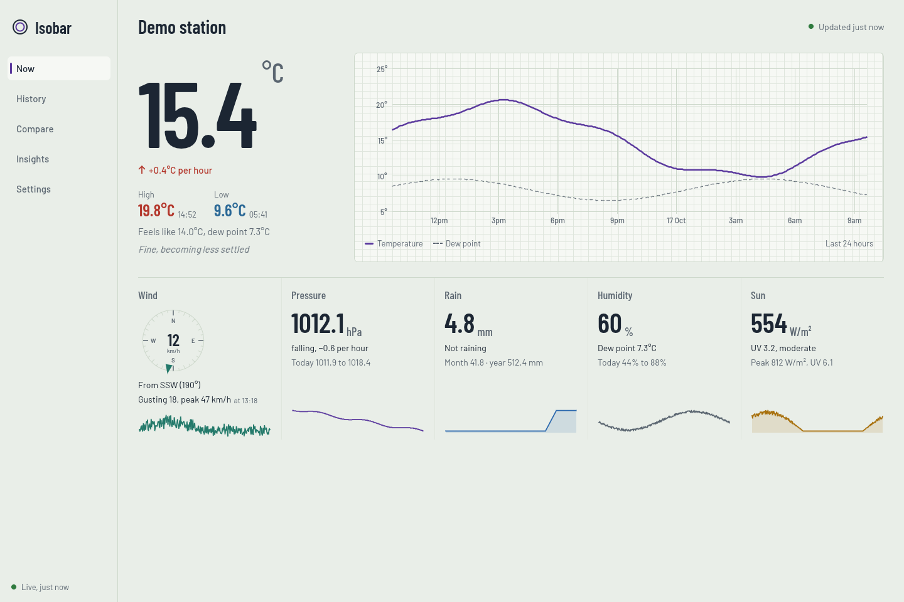
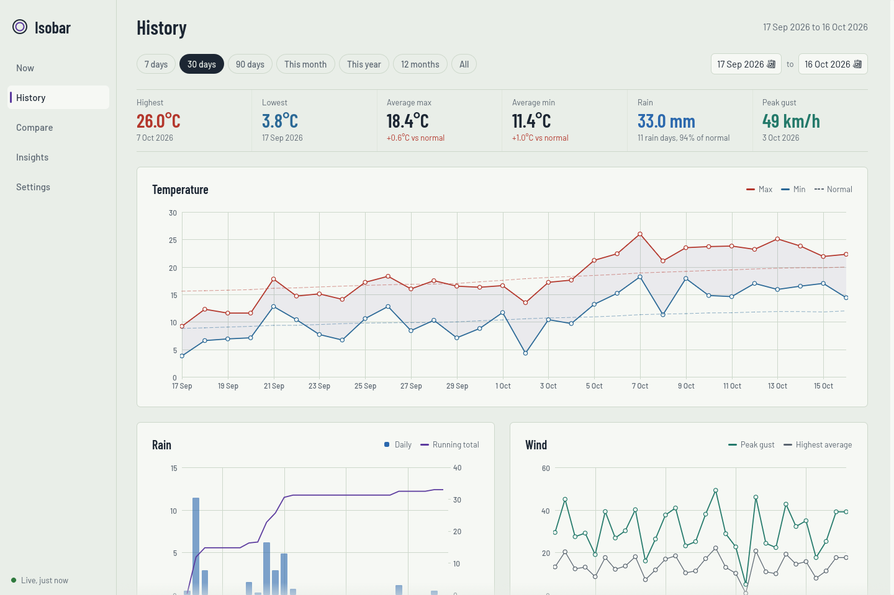

# Isobar

A desktop companion for [Cumulus MX](https://cumuluswiki.org/a/Cumulus_MX) weather stations, for Windows and Linux. Isobar reads live conditions and your station's full daily history straight from MX, keeps a local copy, and turns it into charts, comparisons and records.

It's one program: a single `isobar.exe` on Windows, a single `isobar` file on Linux. There's nothing to install alongside it.



## Getting it

**Download:** the [Releases page](../../releases) has the latest build: `isobar-windows-x64.exe` and `isobar-linux-x64.tar.gz`. Put the file anywhere and open it.

- **Windows:** double-click `isobar-windows-x64.exe`. The first time, Windows SmartScreen may say it doesn't recognise the app, because it isn't code-signed. Choose **More info**, then **Run anyway**.
- **Linux:** unpack it with `tar xzf isobar-linux-x64.tar.gz`, then run `./isobar`.

**Try it without a station:** the first time Isobar opens, choose **Try the demo station**. You get eight years of made-up weather to explore, and nothing about your real setup is saved or changed. (Starting it as `isobar --demo` does the same.)

## Setting up your station

1. Open **Settings**.
2. Enter your MX address, for example `http://192.168.1.20:8998`. It's the same address you use for the MX admin pages in a browser.
3. If you've set a username and password on the MX interface, enter them too.
4. Choose **Test connection**. You should see the current temperature and pressure.
5. Choose **Save settings**.

Isobar then downloads your daily history in the background; the bottom of the left-hand rail shows its progress. From then on it checks for new readings every 10 seconds and new days every 30 minutes.

No MX on the network? Point **Dayfile on this computer** at a `dayfile.txt` instead. Isobar re-reads it whenever it changes.

## Screens

- **Now**: the current temperature with its trend, a 24-hour temperature and dew point trace, and wind, pressure, rain, humidity and sun readouts with 24-hour sparklines. It warns you when the data goes stale or the station can't be reached.
- **History**: range presets or any date range, a summary compared with your station's own normals ("rain 94% of normal"), temperature, rain, wind and pressure charts, and a year heatmap of each day against normal. Hover a chart to read its values; drag across one to zoom in, and double-click to zoom out. Ranges longer than about 200 days switch to weekly values, and longer than three years to monthly values.
- **Compare**: one month (or the whole year) overlaid for every year on record with a ranking table, or two date ranges side by side with wind roses.
- **Insights**: unusual days measured against the seasonal normal for that date, a records board, a monthly climate table and prevailing-wind roses.
- **Settings**: station address, optional login, a dayfile for offline use, alerts and theme.

Desktop notifications cover strong gusts, frost, heat, and rain starting after three dry hours. You set the limits in Settings.



## How it talks to Cumulus MX

| What | Where it comes from |
| --- | --- |
| Live conditions | `GET /api/data/currentdata`, every 10 s by default |
| Daily history | `GET /api/data/dayfile?draw=1&start=N&length=1000`, paged; re-checked every 30 minutes and downloaded again when the line count changes |
| Recent detail (best effort) | `GET /api/graphdata/{temp,press,wind,wdir,rain,hum,solar}data.json`, on first connect |

Isobar also stores one live sample a minute (21 days are kept), so the 24-hour charts fill in even if the graph-data endpoints aren't available.

*Settings → Import a dayfile* merges an archive copy (for example, from an earlier station location) into the local history.

Field positions follow the [Cumulus wiki dayfile table](https://cumuluswiki.org/a/Dayfile.txt). Older lines with fewer fields, semicolon separators and decimal commas are all handled.

## Where Isobar keeps things

- **Settings:** `settings.json` in `%APPDATA%\app.isobar.desktop\` on Windows, `~/.config/app.isobar.desktop/` on Linux. If you set an MX password, it's stored here **unencrypted**.
- **History:** `isobar.sqlite` in `%APPDATA%\app.isobar.desktop\` on Windows, `~/.local/share/app.isobar.desktop/` on Linux. Delete it to start fresh; it rebuilds from MX.

## Building it yourself

You need [Rust](https://rustup.rs). That's all: no Node, no web toolchain.

```sh
cargo run --release            # your station
cargo run --release -- --demo  # the demo station
cargo test --workspace         # the tests
```

`cargo build --release` leaves the program in `target/release/` (`isobar.exe` on Windows). On Windows the Rust installer offers the Microsoft C++ build tools it needs; accept them.

Every push to `main` builds both programs on GitHub Actions and puts them on the Releases page as **Latest build**. Pushing a tag such as `v0.2.0` makes a named release.

## Layout

```
src/                  the app (egui)
  main.rs               starts the window, or the demo with --demo
  worker.rs             background thread: polling, samples, alerts, history sync
  chart.rs, dial.rs     charts, the wind dial and wind roses, drawn on chart paper
  theme.rs              colours, fonts and egui styling
  views/                Now, History, Compare, Insights, Settings
crates/isobar-core/   everything that doesn't need a window (unit tested)
  dayfile.rs            dayfile parser
  live.rs               live JSON mapping
  mx.rs                 MX client
  store.rs              SQLite store
  analytics.rs          normals, anomalies, records, aggregation, cross-year series
  demo.rs               the demo station
assets/               Barlow fonts (built into the program) and icons
```

## Known gaps and next steps

- **Live field names:** these were mapped from MX documentation and an earlier dashboard. If a reading shows "–" on Now, compare the station's `/api/data/currentdata` output with the key lists in `crates/isobar-core/src/live.rs`.
- **Graph-data endpoints:** these vary between MX versions, so they're treated as optional.
- **Units:** taken from the station's live data (`TempUnit` and so on). Charts assume history uses the same units.
- **Ideas:** a system tray readout, a degree-days view, a sunshine/ET panel, CSV export, and secure password storage in the OS keychain.
